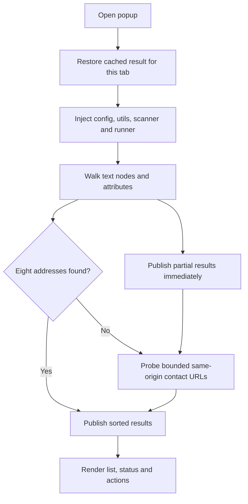

# HTML Email Parser

> A Manifest V3 Chrome extension that extracts business email addresses from the active tab and, when needed, from public contact pages on the same origin.

[](https://chromewebstore.google.com/search/OstinUA)
[](manifest.json)
[](manifest.json)
[](LICENSE)

The extension runs entirely in the browser. It performs two linear passes over the DOM, normalises obfuscated addresses without creating DOM nodes, and only falls back to a small, bounded set of same-origin contact routes when the current page does not expose enough results.

## Contents

- [Features](#features)
- [Architecture](#architecture)
- [Getting started](#getting-started)
- [Usage](#usage)
- [Configuration](#configuration)
- [Security model](#security-model)
- [Development and testing](#development-and-testing)
- [Packaging and release](#packaging-and-release)
- [License and support](#license-and-support)

## Features

- Extraction from text nodes and element attributes, including `mailto:` links, `src`, `srcset`, `aria-label`, `content` and all `data-*` attributes.
- Cloudflare `data-cfemail` decoding with strict payload validation.
- Recovery of bracketed and spelled-out obfuscation (`name [at] domain [dot] com`) and JavaScript string concatenation.
- HTML entity, percent-encoding and full-width Unicode separator normalisation.
- Conservative mailbox validation that rejects image assets, bundle artefacts, hashed identifiers and `www.` hosts.
- Business-oriented ordering that promotes addresses such as `ads@`, `sales@`, `contact@` and `support@`.
- Contact-page augmentation that prefers links discovered on the page, then a short curated path list; requests are concurrent, unauthenticated, size-limited and same-origin only.
- Progressive results: on-page findings appear immediately while contact pages are still being checked.
- Popup with a per-tab session cache, result summary, copy-one / copy-all actions, `mailto:` links, keyboard focus styles, dark mode and an explicit error state.
- No build step for the extension itself: clone the repository and load it unpacked.

## Architecture

```text
manifest.json            Permissions, popup and icon declarations.
popup.html               Static popup shell.
styles.css               Popup styling, including dark mode and reduced motion.
popup.js                 Orchestration: tab lookup, injection, messaging, watchdog.
popup/state.js           Validated state transitions.
popup/render.js          DOM rendering and clipboard feedback.
popup/cache.js           Per-tab results in chrome.storage.session.
content.js               Idempotent injection runner and stop handling.
content/scanner.js       Two-pass DOM scan and bounded contact-page augmentation.
shared/config.js         Runtime limits shared by the popup and content scripts.
shared/email-utils.js    Pure, DOM-free parsing and validation helpers.
scripts/                 Validation, packaging and CI maintenance scripts.
tests/                   Node and Python unit tests.
```

| Component | Responsibility |
| --- | --- |
| `popup.js` | Resolves the active tab, injects the bundle with a per-run token, validates incoming messages and owns the UI watchdog. |
| `content.js` | Supersedes any previous runner in the tab, enforces a hard deadline and cleans up its listener. |
| `content/scanner.js` | Walks text nodes once and element attributes once; probes contact pages within a strict budget. |
| `shared/email-utils.js` | Pure extraction, validation and prioritisation; has no browser dependency and is unit tested in Node. |

There is no background service worker: the popup and content scripts communicate directly, so no always-running extension page is needed.



## Getting started

### Requirements

- Chrome 116 or newer, or another Chromium browser with Manifest V3 support.
- For development tooling only: Node.js 22, Python 3.11 and npm.

### Load unpacked

1. Clone the repository.
2. Open `chrome://extensions` and enable **Developer mode**.
3. Choose **Load unpacked** and select the directory containing `manifest.json`.
4. Pin the extension to the toolbar for quick access.

No bundler, transpiler or package installation is required to run the extension.

## Usage

1. Open the site you want to inspect.
2. Click the extension icon. A cached result for this tab appears immediately while a fresh scan runs.
3. Use **Copy** for one address, **Copy all** for a newline-separated list, or **Mail** to open a `mailto:` link.
4. Click **Refresh** to force a new scan. Chrome blocks injection on `chrome://`, store and other restricted pages; the popup reports this explicitly.

The popup shows the page hostname and a live status line. Contact pages are probed only when the current page is a homepage or yields no addresses.

## Configuration

Runtime limits live in `shared/config.js` and are shared by the popup watchdog and the scanner.

| Constant | Default | Purpose |
| --- | --- | --- |
| `TARGET_RESULT_COUNT` | `8` | Stop augmentation once this many addresses are found. |
| `MAX_RESULT_COUNT` | `50` | Hard ceiling for collected and rendered addresses. |
| `MAX_SCAN_DURATION_MS` | `12000` | Total scan deadline. |
| `POPUP_WATCHDOG_MS` | `16000` | Popup fallback if a scan never reports completion. |
| `FETCH_TIMEOUT_MS` | `3500` | Per-contact-page request timeout. |
| `MAX_CONCURRENT_FETCHES` | `3` | Size of the augmentation worker pool. |
| `MAX_CONTACT_URLS` | `6` | Maximum number of candidate pages per scan. |
| `MAX_TEXT_LENGTH` | `100000` | Per-fragment ceiling before regex processing. |
| `MAX_HTML_LENGTH` | `1500000` | Maximum fetched HTML size that will be parsed. |

Candidate routes are discovered from same-origin links whose path mentions contact, about, support, help, team or imprint, followed by a short static list (`/contact`, `/contact-us`, `/contacts`, `/about`, `/support`, `/help`, `/impressum`, `/team`). Duplicates are removed by normalised path.

## Security model

- **No `host_permissions`.** `activeTab` grants temporary access to the tab the user explicitly invokes the extension on. The old `<all_urls>` grant was removed.
- **Least-privilege messaging.** The popup accepts results only from a content script in the active tab with a matching per-run token; the content script accepts stop requests only from the extension itself.
- **No HTML injection.** All dynamic values are assigned with `textContent` or `dataset`; `innerHTML` is never used for rendering or entity decoding.
- **Bounded untrusted input.** Regex quantifiers follow RFC 5321 limits, text and HTML lengths are capped, and every scan has a deadline.
- **Unauthenticated probing.** Contact-page requests use `credentials: "omit"`, verify the final URL stays on the same origin, and accept only HTML responses.
- **Validated addresses.** Characters that could be interpreted as `mailto:` URL delimiters are rejected before an address is interpolated into an `href`.
- **Supply chain.** CI actions are pinned to commit SHAs, workflows declare explicit minimal permissions, and the analysis workflow never checks out code from a pull request while secrets are present.

## Development and testing

```bash
npm ci
npm run check
npm run package
```

| Command | What it does |
| --- | --- |
| `npm run lint` | ESLint over classic extension scripts and ESM tooling. |
| `npm run validate` | Checks the manifest, permission set, script tags and injected file list. |
| `npm test` | Node unit tests for parsing, scanning, state and manifest integrity. |
| `npm run test:python` | Python unit tests for the CI analysis helpers. |
| `npm run check` | Runs all of the above in sequence. |
| `npm run package` | Builds a deterministic `extension.zip`. |

The scanner tests use a synthetic DOM that throws if `innerHTML` or `innerText` is read, so the linear scanning guarantee cannot regress silently.

For manual validation, test a page with a visible address, an obfuscated address (`hello [at] company [dot] io`), a `mailto:` link, a Cloudflare-protected address and a site whose contact details live only on `/contact`.

## Packaging and release

`npm run package` writes a reproducible archive containing only runtime assets. `scripts/validate.mjs` fails the build if a script is referenced but missing, if inline scripts are introduced, or if broad host permissions are added back.

The **Package Chrome Extension** workflow runs the same checks on manual dispatch, uploads the archive as an artifact and, only when the `publish` input is enabled, uploads a draft to the Chrome Web Store. Increment `manifest.json` and the version badge before publishing.

## License and support

Distributed under the Apache License 2.0. See [LICENSE](LICENSE).

[](https://www.patreon.com/OstinFCT)
[](https://ko-fi.com/fctostin)
[](https://boosty.to/ostinfct)
[](https://www.youtube.com/@FCT-Ostin)
[](https://t.me/FCTostin)

If the extension is useful, consider starring the repository or supporting the author.
